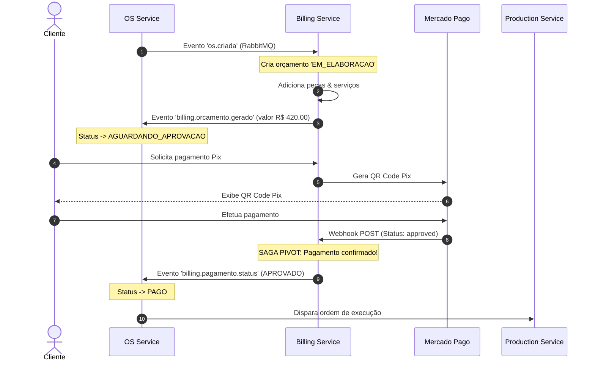

# FIAP Oficina - Microsserviço de Orçamento e Pagamento (Billing Service)

[](https://github.com/marcelsenarios/fiap-oficina-billing-service/actions)


Microsserviço responsável pela **geração de orçamentos (peças e serviços)**, **checkout e liquidação de pagamentos integrados ao Mercado Pago** e pela coordenação da **transação pivot e compensatória do Saga Pattern** (Tech Challenge Fase 4 — Pós-Tech FIAP SOAT).

---

## 1. Responsabilidades do Serviço

- **Composição de Orçamentos**: Inclusão de peças e mão de obra de serviços com cálculo automático do valor total.
- **Integração com Mercado Pago**:
  - Emissão de intenção de pagamento com geração de **Pix copia-e-cola** e QR Code dinâmico.
  - Disponibilização de endpoint de webhook (`/api/v1/webhook/mercadopago`) para confirmação instantânea de pagamentos.
- **Transação Pivot do Saga Pattern**:
  - Ao receber a aprovação do Mercado Pago via webhook, consolida a transação de pagamento no banco e dispara evento `billing.pagamento.status` com status `APROVADO`, liberando a OS para a fila de produção.
- **Transações Compensatórias**:
  - Em caso de rejeição no Mercado Pago ou cancelamento do cliente, notifica o OS Service para executar o rollback transacional.

---

## 2. Tecnologias Utilizadas

- **Linguagem & Framework:** Java 21 LTS + Spring Boot 3.2.5
- **Banco de Dados Relacional (SQL):** PostgreSQL (banco isolado `oficina_billing_db`)
- **Mensageria:** RabbitMQ (AMQP)
- **Gateways Externos:** Mercado Pago API / Webhooks
- **Testes & BDD:** JUnit 5, Mockito, Cucumber BDD e JaCoCo (cobertura mínima de 80%)
- **Documentação:** SpringDoc OpenAPI 3 / Swagger UI (`/swagger-ui.html`)
- **Containerização & Deploy:** Docker multi-stage build e manifestos Kubernetes (HPA, Deployment, Service, ConfigMap, Secrets)

---

## 3. Papel no Saga Pattern



---

## 4. Endpoints Principais (REST API)

- `POST /api/v1/orcamentos`: Iniciar orçamento para uma OS
- `GET /api/v1/orcamentos/{id}`: Buscar orçamento por ID
- `GET /api/v1/orcamentos/os/{osId}`: Buscar orçamento associado à OS
- `GET /api/v1/orcamentos`: Listar orçamentos (filtro por status)
- `POST /api/v1/orcamentos/{id}/itens`: Adicionar peça ou serviço
- `DELETE /api/v1/orcamentos/{id}/itens/{itemId}`: Remover item
- `POST /api/v1/orcamentos/{id}/finalizar`: Finalizar orçamento e notificar OS Service via RabbitMQ
- `POST /api/v1/orcamentos/{id}/pagamento`: Gerar checkout/Pix Mercado Pago
- `POST /api/v1/webhook/mercadopago`: Webhook assíncrono do Mercado Pago
- `POST /api/v1/orcamentos/{id}/cancelar`: Cancelamento / compensação

---

## 5. Como Executar Localmente

### Testes e Verificação de Cobertura JaCoCo
```bash
./mvnw clean verify
```
Relatório JaCoCo gerado em: `target/site/jacoco/index.html`  
Relatório BDD Cucumber em: `target/cucumber-reports/report.html`

### Executar Serviço
```bash
./mvnw spring-boot:run
```
Acesse a documentação Swagger em: `http://localhost:8082/swagger-ui.html`
